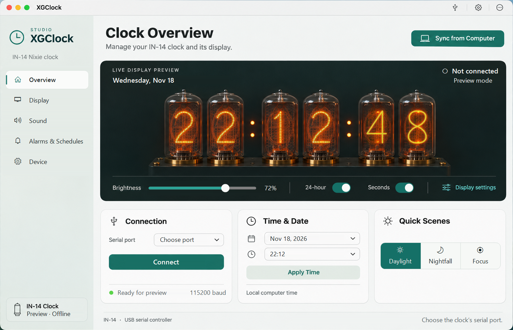
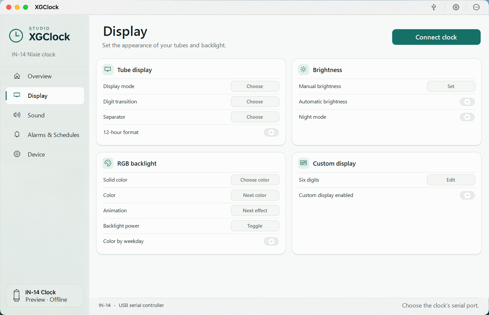
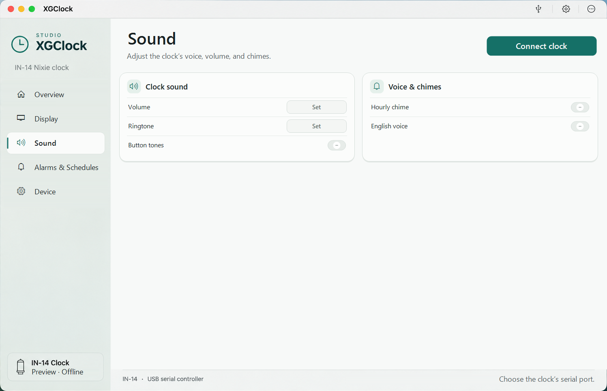
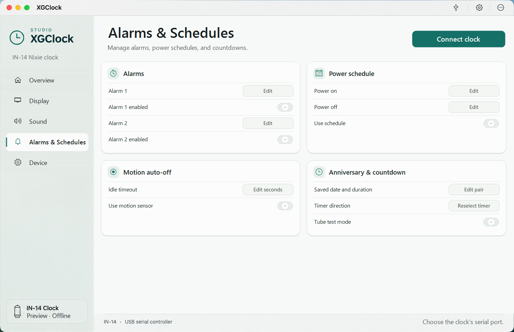
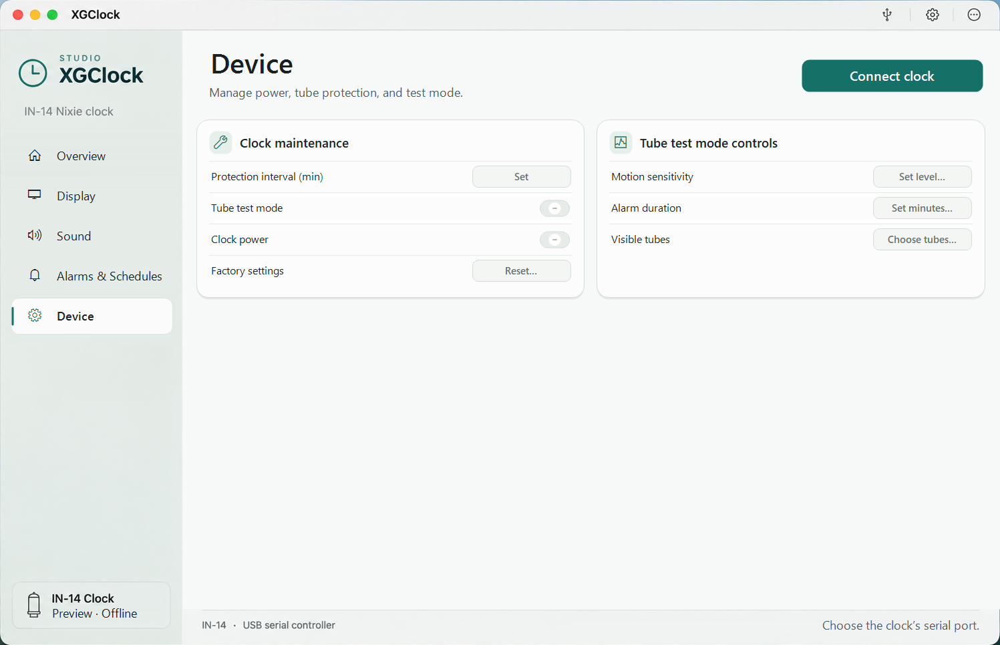

# XGClock Studio

**[Download XGClock Studio for Windows (ZIP)](https://github.com/Frozt-src/Open-Nixie-Studio/releases/latest/download/XGClock-Studio-Windows.zip)**

Extract the ZIP and open **NixieStudio.exe**. Studio controls XG-IN1406M v3 Nixie clocks and starts in preview mode. It runs on Windows 10 version 1703 or later, or Windows 11, with .NET Framework 4.8 or later.

## Connect over Bluetooth LE

1. Power on the clock and turn on Bluetooth in Windows. You’ll need a Bluetooth LE adapter, either built in or connected by USB.
2. In Studio’s **Overview**, open **Choose port** in the **Connection** card and select **Find a Bluetooth clock…**.
3. Select your clock (for example, **XG-IN1406Mv3.0**) and click **Connect**. If the list stays empty, bring the clock closer and disconnect any other Bluetooth client using it.
4. Wait for **Clock settings received** at the bottom of the window. The connection should show **Bluetooth LE**. Use **Read settings** to refresh the values later.

Studio uses the Windows Bluetooth LE stack and the clock’s FFF1/FFF2 characteristics. The Bluetooth address stays in memory.

## Screenshots



<details>
<summary>View Display, Sound, Alarms &amp; Schedules, and Device</summary>

**Display**



**Sound**



**Alarms & Schedules**



**Device**



</details>

## Connect over USB

If Windows does not list the clock as a COM port, it may need a USB-to-serial driver.

1. Connect the clock with a USB data cable. Close any other controller using that port.
2. Open **Serial port** and select the clock's port. Studio opens it at 115200 baud, 8 data bits, no parity and one stop bit.
3. Wait for **Clock settings received**. **Read settings** refreshes device state. Use **Sync from Computer** only when you intend to set the clock's local date and time.

Hardware verification on November 18, 2026 completed a full settings read over both USB and Bluetooth LE. On USB the controller also wrote the existing hour format and independently read it back. Individual effects, alarms, factory reset and the full range of firmware settings have not all been exercised with this build.

## Controls

| Page | Hardware functions |
| --- | --- |
| Overview | Connection, settings refresh, local or manual time and date, brightness, 12/24-hour format and brightness scenes |
| Display | Time, date, timer and anniversary modes, transitions, separators, custom digits, ambient brightness, night mode, RGB color, backlight effects and backlight power |
| Sound | Volume, ringtone, hourly chime, voice language and button tones |
| Alarms & schedules | Two alarms, scheduled power, motion auto-off, anniversary date and countdown duration, timer direction |
| Device | Power, tube protection, test mode, motion sensitivity, alarm duration, per-tube visibility and confirmed factory reset |

In the overview, right-click the tubes for preview options. Tab moves between controls. The arrow keys adjust focused brightness. The Seconds switch affects the on-screen preview. Daylight, Nightfall and Focus request brightness levels on the clock.

The settings reader collects 21 records before enabling writes. Ordinary settings get a separate readback after the clock acknowledges the write. Commands such as advancing an effect have an acknowledgment only. Studio never automatically repeats an action that could cycle a setting twice. A timeout during a multi-packet edit can leave part of the edit applied. Reconnect and read the settings before retrying.

### Tube test mode

The firmware gives some controls a second meaning in tube test mode. Use **Device** to enable test mode, wait for readback, set motion sensitivity, alarm duration or the visibility mask, then turn test mode off. These secondary values are not returned by the ordinary settings dump. A mask of `001100` lights only the two middle tubes.

**Edit pair** replaces both the anniversary date and countdown duration. Enter both deliberately. The editor temporarily enables test mode when needed and restores its previous state after the write. The firmware does not supply the previous pair during a normal settings read. Reselecting Timer in test mode requests a direction change. Watch the physical display to check direction.

### Preview and scope

The preview shows computer time until Studio sends a time update. Timer values, anniversary counts, physical tilt gestures, ambient light measurements and intermediate backlight animation frames are not streamed in the settings dump. Timer and anniversary modes therefore blank the simulated digits. The app refreshes ordinary settings when idle in the foreground. Acknowledgment of an RGB command does not measure the light emitted by the clock.

The intended hardware is the XG-IN1406M v3. Other clock families and firmware revisions have not been qualified. The manufacturer hosts the clock's manual at [diym.vip](https://diym.vip/).

## Build and test

Use Windows PowerShell 5.1 with .NET Framework 4.8 and a Windows 10 or 11 SDK installed. Build tools are required only on the development PC. The build uses the system C# compiler and Windows SDK metadata and restores no external packages.

```powershell
.\build.ps1 -Test -Package
.\tests\check-ui.ps1
```

The executable is written to `out`. The two distribution archives and their SHA-256 checksums are written to `release`. The source ZIP can be extracted and built independently.

For an optional hardware check, supply the clock's actual COM port.

```powershell
.\tests\check-device.ps1 -Port $clockPort
```

Adding `-VerifyWrite` writes back the current hour-format value and verifies it with another full settings read. The default check only reads settings.

## Distribution and privacy

Code and included interface artwork are distributed under the MIT license. The project is independent of the hardware manufacturer. The release contains no vendor executables, drivers, device captures, saved settings, signing identities or account credentials. Runtime port discovery and the date shown in the interface come from the current Windows session. The executable does not persist a device address, serial port, application log or user profile.

